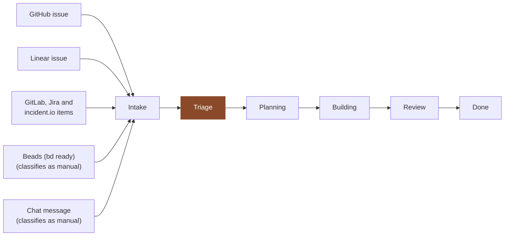

<div align="center">

# 🏭 Samskara

### A factory floor for agent work — with chat as a front door.

**Samskara is a self-hosted [Mastra Factory](https://factory.mastra.ai/): a shared workspace where work moves across a board and every stage is an agent.** Intake, triage, planning, building, review — each one a specialised agent running a skill you can replace, with humans approving at the gates between them. It remembers what it learns about a codebase and applies that next time instead of rediscovering it.

[](LICENSE)
[](#-setup)
[](https://factory.mastra.ai/)
[](https://turso.tech)
[](https://e2b.dev)

</div>

---

> Authentication, database, sandbox and models are four independent choices. Samskara runs all four on infrastructure you control. Any one of them can point at Mastra's hosted platform instead.

## ⚡ What it does

Mention the bot in a channel:

> _"@Samskara the CSV export drops the last row"_

A session starts on its own git branch. The triage agent works out what the request actually is, planning proposes an approach, and the plan goes up for approval before anything is written. GitHub and Linear issues enter the same board and take the same path.

The boards here are configured for software delivery, which is what the stock Factory ships. The model underneath is not specific to code — [Translucent](https://mastra.ai/customers/translucent) runs accounting jobs on a Factory: posting journals, reconciling balances, escalating to a human when the evidence is not conclusive.

## 🧩 The four choices

| Part | What Samskara runs | Other options |
|------|--------------------|---------------|
| **Authentication** | Better Auth, self-hosted | [configure/auth](https://factory.mastra.ai/configure/auth) |
| **Database** | libSQL file, or [Turso](https://turso.tech) | [configure/storage](https://factory.mastra.ai/configure/storage) |
| **Sandbox** | [E2B](https://e2b.dev) | [configure/sandboxes](https://factory.mastra.ai/configure/sandboxes) |
| **Models** | Your own provider keys | [configure/models](https://factory.mastra.ai/configure/models) |

Deployment shapes are covered in Mastra's [deployment guide](https://factory.mastra.ai/deployment#self-host); every server setting is in [reference/configuration](https://factory.mastra.ai/reference/configuration).

## 🔒 Picking a sandbox

The sandbox is where agent-authored commands run, against a repository you have connected. Set it with `FACTORY_SANDBOX_PROVIDER`: `local`, `e2b` or `platform`.

`local` runs on every platform. What confines it depends on the platform:

| Platform | Backend | Confined |
|----------|---------|----------|
| macOS | `seatbelt` | yes |
| Linux | `bwrap` | only with bubblewrap installed (`apt install bubblewrap`) |
| Windows | none available | **no** |

The backend is resolved at startup and logged:

```
[sandbox] isolation=seatbelt
[sandbox] isolation=none — Native sandboxing is not supported on win32. …
```

Network stays open inside the sandbox: the Factory clones and pushes through it. On macOS, seatbelt confines writes to the session checkout and temp directories but can read the whole disk; bubblewrap on Linux hides the host filesystem as well.

Windows has no backend ([mastra-ai/mastra#20304](https://github.com/mastra-ai/mastra/issues/20304) — the fix raises an error for an unavailable backend rather than adding one). Docker is the way to get isolation there without a cloud provider.

Samskara wires E2B. Mastra also ships adapters for
[AgentCore](https://mastra.ai/integrations/sandboxes/agentcore),
[Apple Container](https://mastra.ai/integrations/sandboxes/apple-container),
[Blaxel](https://mastra.ai/integrations/sandboxes/blaxel),
[Cloudflare](https://mastra.ai/integrations/sandboxes/cloudflare-sandbox),
[Daytona](https://mastra.ai/integrations/sandboxes/daytona),
[Docker](https://mastra.ai/integrations/sandboxes/docker),
[Modal](https://mastra.ai/integrations/sandboxes/modal),
[Railway](https://mastra.ai/integrations/sandboxes/railway) and
[Vercel](https://mastra.ai/integrations/sandboxes/vercel).

## 🔀 What differs from a stock Factory

A Factory scaffolded with `npm create factory` behaves as the left column describes. Each row was checked against a real scaffold.

| | Stock scaffold | Samskara |
|---|---|---|
| **Database** | `DATABASE_URL` set → Postgres; unset → local libSQL file in dev/test, and a hard throw outside them | libSQL and Turso. `DATABASE_URL` is read, ignored, and warned about |
| **Vector store** | `PgVector` when `DATABASE_URL` is set; otherwise **none at all** | `LibSQLVector` always — its own file locally, sharing the Turso database unless `TURSO_VECTOR_DATABASE_URL` splits them |
| **Sandbox** | Only `FACTORY_SANDBOX_PROVIDER=local` is read. Otherwise platform → E2B → local, silently | The value is validated. An explicit choice missing its credentials throws at startup |
| **Chat-sourced work** | The Work board declares triage for every tracker source but not `manual` | Samskara's Work board, which replaces the built-in by id, declares it for `manual` too. See the caveat below — Slack cards skip Triage |

**Database.** Most deploy platforms inject `DATABASE_URL` automatically. On the stock scaffold that repoints the whole backend at a Postgres instance you did not pick — and with `NODE_ENV` set to anything but `development` or `test`, its absence is a startup error rather than a libSQL fallback. Samskara ignores the variable and logs a warning.

**Sandbox.** A missing or mistyped `E2B_API_KEY` on the stock scaffold falls through to running agent commands on the host, with no signal.

## 📋 How work moves

Work enters at Intake and moves through five more phases. Each phase runs a handler, and the handler is chosen by where the item came from.



Triage is the phase that matters here. On the stock Work board it declares a handler for every tracker source, but not for `manual` (`@mastra/factory` 0.20.0 `dist/boards/work.js:157-163`):

```js
triage: {
  onEnter: {
    issue: triageIssueEntry,
    gitlabIssue: investigateTriagedGitLabIssue,
    linearIssue: investigateTriagedLinearIssue,
    jiraIssue: investigateTriagedJiraIssue,
    incidentioFollowUp: investigateTriagedIncidentioFollowUp,
  },
},
```

A chat message classifies as `manual`, so it reaches Triage, matches no handler, and gets a generic stage message instead of the triage skill. Planning and Building already handle `manual`, so the card then continues normally. A beads card also classifies as `manual` ([docs/operations/beads.md](docs/operations/beads.md)).

`src/mastra/boards/requests-board.ts` is the exported Work board with two changes: Triage also declares `manual`, and its Done phase declares a `manual` handler that wakes the beads write-back (`requests-board.ts:63-69`). It is installed under the id `work` with `includeDefaultBoards: false`, the replacement path Mastra documents, so it takes the built-in's place and everything keyed to `work` (the GitHub PR rules, plan approval, triage classification, the UI's Work page) applies to it unchanged. Review is reinstalled as-is. See [docs/boards.md](docs/boards.md).

### The caveat: Slack cards skip Triage

In `@mastra/factory` 0.20.0 a dispatched Slack thread creates its card directly at Building with no board assigned:

```js
// integrations/slack/slack.js
input: { title, externalSource: {...}, stages: ["execute"] }   // no `board`
```

With `board` unset, `boardForWorkItem()` resolves it to `work`, which is Samskara's board, so the card is on the right board, but it never passes through Triage. The Slack integration exposes no option for the stage. A card is created at all only when the factory's **Create work items for new Slack threads** setting is on; it is off by default ([docs/setup/slack-app.md](docs/setup/slack-app.md#where-slack-work-lands)).

A card can be re-filed by hand — `PATCH /web/factory/work-items/:id` with `{"board":"work","stages":["triage"]}`, sent from a signed-in session, is accepted while its board is still null — but that is one call per card, after the run has already started. Filing Slack work into Triage needs routing upstream does not yet provide; the Slack integration's own comment calls it a planned follow-up.

## 🚀 Setup

The runbooks in [`docs/setup/`](docs/setup/) take a fresh clone to a running Factory. They are written to be followed by an AI coding agent — steps only a human can do are marked **HUMAN**.

| # | Runbook | What it gets you |
|---|---------|------------------|
| 1 | [mastra-docs-mcp.md](docs/setup/mastra-docs-mcp.md) | Documentation tooling, so later steps are verified rather than guessed |
| 2 | [secrets-infisical.md](docs/setup/secrets-infisical.md) | A secret store, with every key this project needs created as a placeholder |
| 3 | [tunnel.md](docs/setup/tunnel.md) | A public HTTPS address, for local development only |
| 4 | [github-app.md](docs/setup/github-app.md) | Repository access and issue intake |
| 5 | [slack-app.md](docs/setup/slack-app.md) | Chat intake (optional) |
| 6 | [deploy-coolify.md](docs/setup/deploy-coolify.md) | An always-on server deployment (optional) |
| 7 | [new-project.md](docs/setup/new-project.md) | A factory with its repositories, models, Slack routing and beads, ready for work |

Running Samskara both locally and on a server? Read [environments.md](docs/setup/environments.md) first: each environment needs its own GitHub App and Slack app, and a repository is worked in one environment only.

```bash
npm install
cp .env.example .env # then set MASTRA_DB_PATH in it (below)
mkdir data           # libSQL does not create the folder
npm run dev          # plain .env; generates dev auth secrets on first run
npm run dev:secure   # secrets injected from Infisical
```

Before the first `npm run dev`, set `MASTRA_DB_PATH` in `.env` to an absolute path inside this repository, for example `<repo>/data/samskara.db`. Unset, the server opens the Mastra Code CLI's shared `mastra.db` and `mastra-vectors.db`; see `.env.example`.

UI and API serve together on <http://localhost:4111>. Requires Node.js 24.21.0+.

Once the server is running, [new-project.md](docs/setup/new-project.md) takes you from an empty organization to a card moving across the board.

## 🛠️ Working on it

Mastra ships first-party tooling for coding agents. Install it before touching anything, including before filing an issue, so what you report is checked rather than remembered — Mastra ships breaking minors weekly, and a remembered answer is usually a stale one.

```bash
npx skills add mastra-ai/skills --skill '*' -y   # the two skills below
npx skills list                                   # what is installed, and where
```

- **`mastra`** — the framework guide: agents, workflows, tools, memory, storage, and the `mastra api` CLI.
- **`mastra-factory`** — operating a running Factory through `mastra api factory`: status, queues, work items, metrics, health, supervisor sessions.

`skills-lock.json` pins both. The files themselves are fetched, not checked in, so they stay current with upstream.

The docs MCP server needs nothing: `.mcp.json` is checked in and `@mastra/mcp-docs-server` arrives with `npm install`. Together these give four sources, in descending order of authority: the `mastra` skill, the docs each package embeds under `dist/docs`, the installed package itself, and the MCP server for packages that embed none — `@mastra/factory` among them, which is most of what this project touches.

```bash
npm run check        # tsc --noEmit
npm run check:auth-parity   # fails if @mastra/auth-better-auth's init() changed (CI runs it)
npm test             # vitest: tier-1, real temp libSQL, no server
npm run test:e2e     # playwright: invite flow on port 4199, throwaway DB
npm run build        # bundles to .mastra/output
npm run db:backup    # snapshot to ~/.samskara-backups (VACUUM INTO); needs MASTRA_DB_PATH
```

`npm start` (varlock) and `npm run start:secure` (development secrets from Infisical) run the built output; neither is how production starts, which is the Docker image running `node index.mjs`. `npm run deploy` (`mastra deploy`) is not used by this project.

> **`mastra build` deletes the whole `.mastra/` directory.** Nothing worth keeping belongs there — the database lives in `data/` when `MASTRA_DB_PATH` points there, which is the reason to set it, and backups are written outside the repository.

## ⚙️ Configuration

`.env.example` documents every variable. These decide the shape of a deployment:

| Variable | Effect |
|----------|--------|
| `MASTRACODE_PUBLIC_URL` | The origin users reach the Factory at. Builds OAuth callbacks and the links posted into chat, so a `localhost` value produces links nobody else can open |
| `FACTORY_SANDBOX_PROVIDER` | `local`, `e2b` or `platform` — see above |
| `TURSO_DATABASE_URL` + `TURSO_AUTH_TOKEN` | A hosted database. Without them, a local file that does not survive a container restart and cannot be shared across replicas |
| `MASTRA_DB_PATH` | Local only: where that file lives. Unset, it is the Mastra Code CLI's own `mastra.db` in the user's app-data directory, shared with the CLI |
| `FACTORY_CREDENTIAL_ENCRYPTION_KEY` | Encrypts stored provider credentials. Lose it and they are unreadable |
| `BEADS_INTEGRATION` | Beads intake and write-back, on by default; `0`, `false`, `off` or `no` turns it off. See [docs/operations/beads.md](docs/operations/beads.md) |

Secrets belong in a secret manager, not `.env` — see [secrets-infisical.md](docs/setup/secrets-infisical.md). An entry in `.env` shadows an injected value, so a key should live in one place.

## 📚 Documentation

| | |
|---|---|
| [docs/setup/](docs/setup/) | Getting a deployment running |
| [docs/architecture.md](docs/architecture.md) | How `src/mastra/index.ts` is organised, and why |
| [docs/boards.md](docs/boards.md) | Phases, handlers, and four things that will catch you |
| [docs/operations/](docs/operations/) | Backup and restore, the beads integration, Better Auth migrations, outbound mail, the session cache, team invites, Turso, upgrading Mastra, white-labelling the UI |
| [docs/troubleshooting.md](docs/troubleshooting.md) | Failures that are hard to diagnose from the symptom |

## 🤝 Contributing

Detailed issues, not pull requests — [CONTRIBUTING.md](CONTRIBUTING.md). For vulnerabilities, [SECURITY.md](SECURITY.md).

## 📄 Licence

[Apache-2.0](LICENSE).
